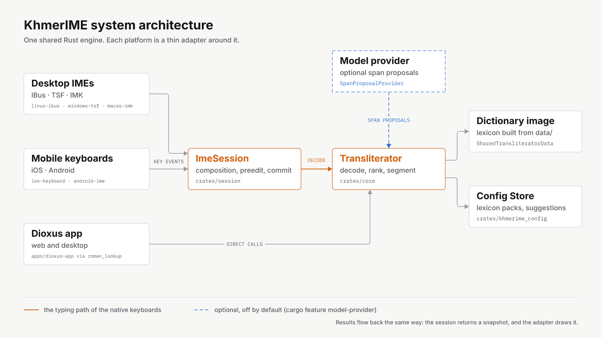
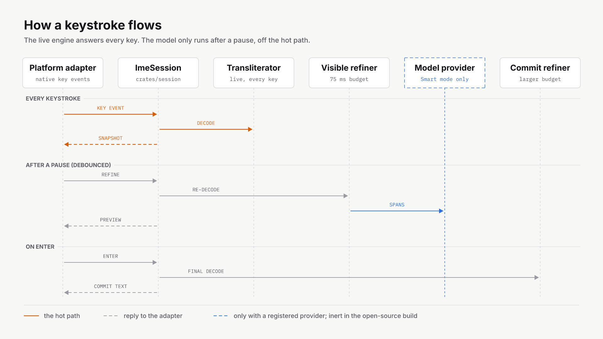

# KhmerIME

Type `nhomtovsalarien` and get `ខ្ញុំទៅសាលារៀន`.

<!-- TODO: demo GIF here -->

KhmerIME is a cross-platform Khmer input method engine built around a shared Rust
core. It provides consistent transliteration behavior across platforms while
keeping native integrations thin and platform-specific.

## Why KhmerIME

KhmerIME is designed as one input engine with multiple platform adapters. The
core transliteration behavior — decoding, ranking, segmentation, and candidate
selection — lives in:

- [crates/core/](crates/core) — the transliteration engine
- [crates/session/](crates/session) — the platform-neutral session contract

Platform integrations such as IBus, Windows TSF, macOS IMK, iOS keyboard, and
Android IME are intentionally thin. Their responsibility is to translate native key
events, lifecycle events, and platform behavior into the shared session contract.
The Dioxus app (web and desktop) is the exception today: it calls the
`Transliterator` directly and keeps its own editor flow in `apps/dioxus-app/src/ui/editor/`.

This architecture keeps the typing experience consistent across platforms while
allowing platform-specific development to move independently.

<picture>
  <source media="(prefers-color-scheme: dark)" srcset="docs/diagrams/system_architecture.png">
  
</picture>

In short:

- One shared engine.
- Thin native adapters.
- Consistent behavior everywhere.
- Locked regression surface.

## Getting Started

```bash
make help
```

`make help` lists the available developer commands, including commands for running
apps, querying the engine, building data, and working with platform adapters.

For full build, run, and verification instructions, see
**[docs/development.md](docs/development.md)**.

## Project Layout

```text
crates/core/       Transliteration engine: lexicon, decoder, ranking
crates/session/    Platform-neutral session contract and state machine
adapters/          Native integrations for Linux, Windows, macOS, iOS, and Android
apps/              Dioxus app and lookup CLI
data/              CSV lexicon and compiled data sources
docs/              Development, architecture, platform, and design documentation
```

## Design Principles

- Keep transliteration behavior in one shared engine.
- Keep platform adapters thin and predictable.
- Avoid platform-specific logic drift.
- Preserve a stable regression surface for decoding and ranking.
- Prioritize low-latency typing behavior.
- Make platform development possible without changing the core typing experience.

## How a keystroke flows

Every native platform adapter receives key events from its host IME framework and
routes them into the shared `ImeSession`. The session drives the `Transliterator` core,
which decodes roman input, ranks candidates, and segments phrases. The result
flows back through the adapter to update the preedit or commit text in the
application. The adapter and the bridge mechanism differ per platform (see
[docs/platforms/](docs/platforms/)).

## Bring your own model

The decoder is deterministic by design, but romanized Khmer is ambiguous — `kmean` has
several valid readings and only context decides between them. So the engine exposes a
seam where a learned model can propose word spans, behind a trait, off the keystroke hot
path, under a latency budget, with the deterministic engine still holding the final say.

With no provider registered the seam is inert and the keyboard behaves exactly as it does
today. Plug one in and it starts influencing ranking, with model-derived candidates marked
as such.

If ambiguous-script input interests you, that seam is an open invitation:
**[docs/model-provider-challenge.md](docs/model-provider-challenge.md)**.

<picture>
  <source media="(prefers-color-scheme: dark)" srcset="docs/diagrams/keystroke_flow.png">
  
</picture>

## Docs

- [docs/development.md](docs/development.md) — how to run and verify the project
- [CONTRIBUTING.md](CONTRIBUTING.md) — contribution rules and required checks
- [CONTEXT.md](CONTEXT.md) — domain vocabulary and how the pieces relate
- [docs/platforms/](docs/platforms/) — per-platform native packaging and install
- [docs/architecture/](docs/architecture/) — cross-platform performance patterns and subsystem design
- [docs/adr/](docs/adr/) — architecture decision records
- [docs/model-provider-challenge.md](docs/model-provider-challenge.md) — the span-proposal seam, and an invitation to plug your own model into it
- [docs/known-limitations.md](docs/known-limitations.md) — behaviors that look like bugs but are not fixable here

## Data Credits

KhmerIME uses data and references from the following open-source projects:

- khPOS: https://github.com/ye-kyaw-thu/khPOS/tree/master
- Khmerlang Keyboard: https://github.com/khmerlang/Khmerlang-Keyboard
